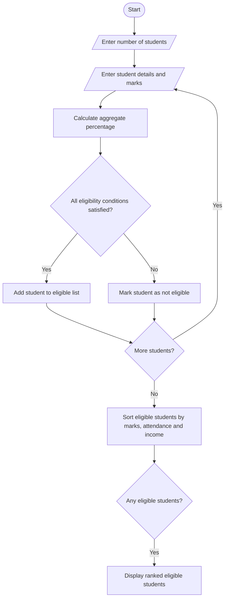

# Problem Statement
To develop a Python program for a University Scholarship Allocation System that evaluates students based on aggregate marks, subject-wise minimum marks, attendance percentage, and family annual income. The system identifies eligible students, ranks them according to their academic performance, and resolves ties using predefined rules.
# Algorithm
1. Start the program.
2. Read the number of students.
3. For each student, enter their name, subject marks, attendance percentage, and annual family income.
4. Calculate the aggregate percentage of marks.
5. Check whether the student satisfies all the eligibility criteria:
   - Aggregate percentage must be at least 75%.
   - Each subject mark must be at least 60%.
   - Attendance must be at least 75%.
   - Annual family income must not exceed ₹2,50,000.
6. If all conditions are satisfied, mark the student as eligible.
7. Rank eligible students according to aggregate percentage in descending order.
8. If two students have the same aggregate percentage, give priority to the student with higher attendance. If attendance is also equal, give priority to the student with lower family income.
9. Display the eligible students, their marks, and their ranks.
10. Display a message if no students are eligible.
11. Stop the program.
Note: The eligibility limits and tie-breaking rules above are example rules for this project. Actual scholarship policies may use different criteria.

# input code
name = input("Enter student name: ")

m1 = float(input("Enter marks in Subject 1: "))
m2 = float(input("Enter marks in Subject 2: "))
m3 = float(input("Enter marks in Subject 3: "))

attendance = float(input("Enter attendance percentage: "))
income = float(input("Enter annual family income: "))

aggregate = (m1 + m2 + m3) / 3

print("Student Name:", name)
print("Aggregate Percentage:", aggregate)
print("Attendance:", attendance)
print("Annual Family Income:", income)
# Sample Input
Enter number of months: 3

Month 1
Enter month name: January
Enter units consumed: 80

Month 2
Enter month name: February
Enter units consumed: 120

Month 3
Enter month name: March
Enter units consumed: 250
ents]
    K --> M([Stop])
    L --> M
# Expected Output
--- Monthly Electricity Bills ---

Month: January
Units: 80.0
Electricity Bill: Rs. 198.0

Month: February
Units: 120.0
Electricity Bill: Rs. 417.5

Month: March
Units: 250.0
Electricity Bill: Rs. 1025.0

--- Bill Comparison ---

February - Change: Rs. 219.5
Warning: Unusual bill increase!

March - Change: Rs. 607.5
Warning: Unusual bill increase!
